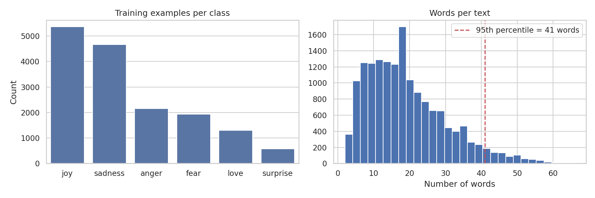
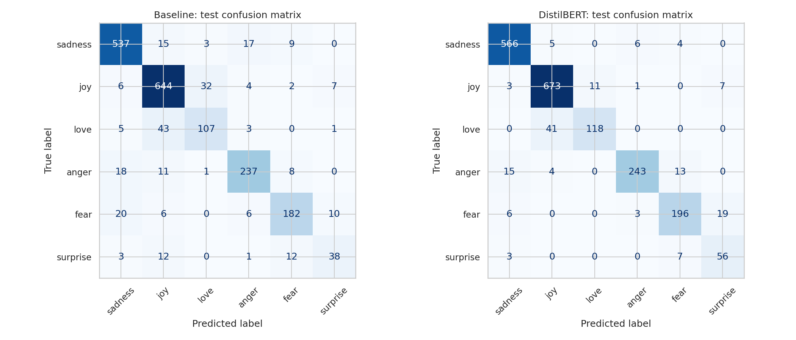
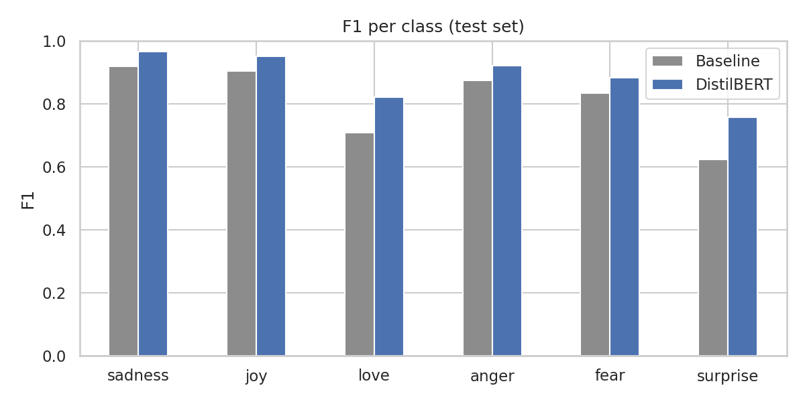

# Emotion Classification with DistilBERT

Fine-tuned DistilBERT to classify short texts into 6 emotions (sadness, joy, love, anger, fear, surprise), benchmarked against a TF-IDF + Logistic Regression baseline.

**Model:** https://huggingface.co/huggingFace2033/distilbert-emotion

## Data
`dair-ai/emotion`: 16000 train / 2000 validation / 2000 test. The classes are imbalanced.  I reported **macro-F1**, which weights every class equally, alongside accuracy.

## Approach
1. **Baseline:** TF-IDF (unigrams and bigrams) + Logistic Regression, with `C = 100` selected on the validation set.
2. **Main model:** `distilbert-base-uncased` fine-tuned for 3 epoch(s) (learning rate 2e-05, batch size 16, max length 64); best epoch chosen by validation macro-F1.
3. The test set was used once, for the final comparison.

## Results (test set)

| Model                        | Accuracy | Macro-F1 |
|------------------------------|:--------:|:--------:|
| TF-IDF + Logistic Regression | 0.873    | 0.810    |
| DistilBERT (fine-tuned)      | 0.926    | 0.882    |

## Tech stack
Python, PyTorch, Hugging Face Transformers and Datasets, scikit-learn, pandas, Gradio
